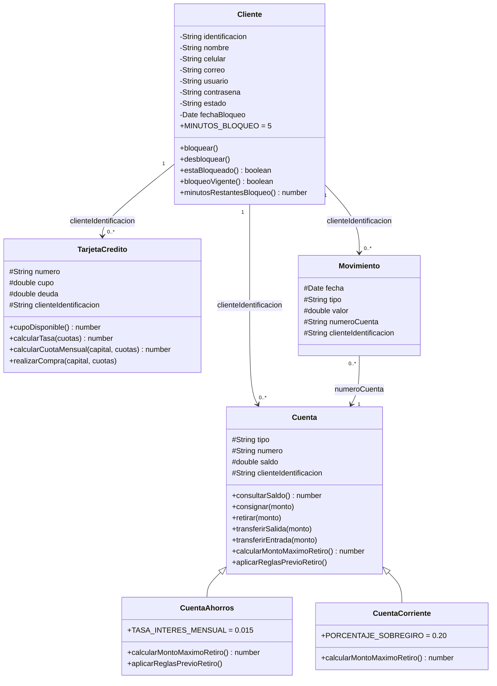
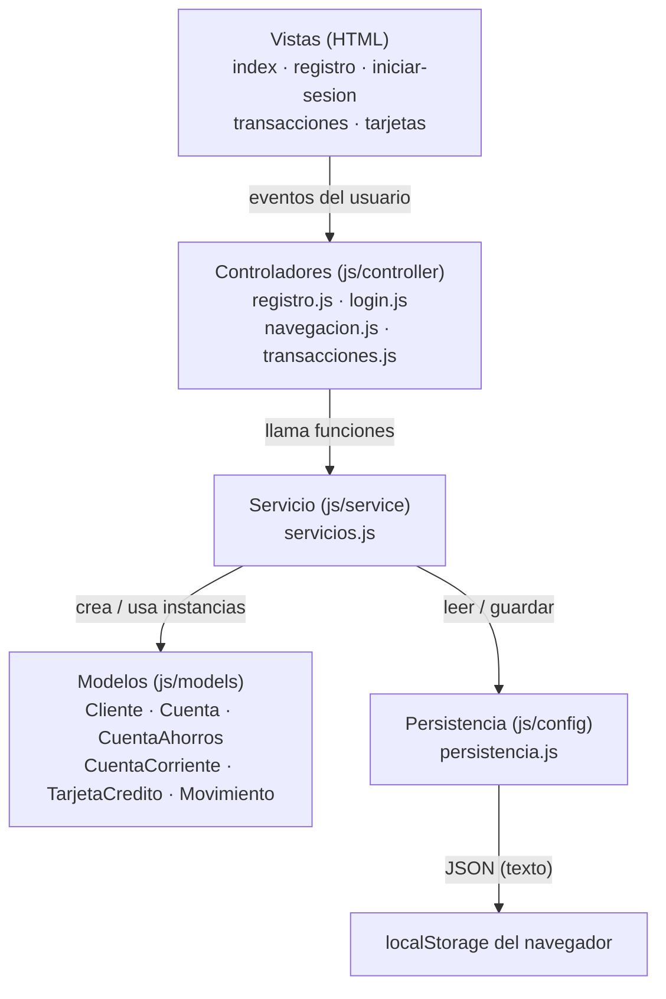

# UML — Mi Plata Financial Bank

Diagramas del proyecto para la exposición.

## Archivos

| Archivo | Qué es | Cómo abrirlo |
|---|---|---|
| `diagrama-clases.drawio` | Diagrama UML completo (2 páginas: **Diagrama de clases** y **Arquitectura por capas**) | [draw.io](https://app.diagrams.net) → *Open Existing Diagram*, o la extensión **Draw.io Integration** de VS Code |
| `README.md` | Versión Mermaid (se ve renderizada en GitHub / el visor) + guion para exponer | — |

> El `.drawio` es un solo archivo con **dos pestañas** (abajo del lienzo).

---

## 1. Diagrama de clases (Mermaid)

**Simbología:** `+` público · `#` protegido · `-` privado · `<|--` herencia · `-->` asociación · `"1"` y `"0..*"` multiplicidad.

---

## 2. Arquitectura por capas (Mermaid)

**Regla de oro:** el controlador **nunca** toca `localStorage`; siempre pasa por el servicio. El servicio es el único que habla con la persistencia y con los modelos.

---

## 3. Guion para exponer

1. **Qué es:** un cajero virtual bancario hecho en JavaScript con módulos ES y POO, que guarda todo en el `localStorage` del navegador.
2. **Capas (página 2 del `.drawio`):**
   - **Vistas (HTML):** solo estructura; no tienen lógica.
   - **Controladores:** capturan los eventos, leen los inputs, llaman al servicio y pintan la respuesta. No tocan los datos.
   - **Servicio (`servicios.js`):** el corazón. Aplica las reglas y siempre devuelve `{ exito, mensaje, ... }`.
   - **Modelos:** las clases con sus reglas (Nivel 2: campos privados `#` y accesores `get`/`set`).
   - **Persistencia (`persistencia.js`):** envuelve `localStorage` y guarda/lee JSON.
3. **Clases (página 1 del `.drawio`):**
   - **Cliente:** datos del usuario y el control de bloqueo por 3 intentos fallidos (`MINUTOS_BLOQUEO = 5`).
   - **Cuenta:** clase base con saldo, consignar, retirar y transferencias.
   - **CuentaAhorros / CuentaCorriente:** **herencia** de `Cuenta`. Ahorros aplica **1.5%** de interés y la Corriente permite **20% de sobregiro** → **polimorfismo** en `calcularMontoMaximoRetiro()`.
   - **TarjetaCredito:** cupo, deuda, tasas por cuotas (`≤2`: 0%, `3-6`: 1.9%, `≥7`: 2.3%) y la cuota mensual.
   - **Movimiento:** registra cada operación (fecha, tipo, valor, cuenta y dueño) para el historial.
4. **Relaciones:** un `Cliente` tiene 1 → muchas `Cuenta`, `TarjetaCredito` y `Movimiento` (se enlazan por `clienteIdentificacion`). `CuentaAhorros` y `CuentaCorriente` **heredan** de `Cuenta`.
4. **Reglas de negocio para resaltar:**
   - Ahorros: suma el 1.5% de interés **antes** de retirar.
   - Corriente: permite sobregiro del 20%.
   - Transferencia: primero retira del origen y solo si funciona abona al destino (evita "crear dinero" si algo falla).
   - Movimientos: cada operación exitosa se registra y el historial se muestra del más reciente al más antiguo.
